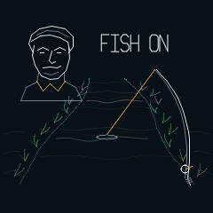
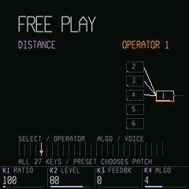

# BLACKWATER

**An ambient musical river for the M-VAVE FM-1.**

Play a note and send a coloured crest downstream. Settle into slow, evolving FM sound, watch the riverbank come
to life, then feel the scene gather into a tense fishing encounter before returning to the current.

**[Install on your FM-1](https://michaelaperry.github.io/Blackwater/install/)** ·
[Play in the browser](https://michaelaperry.github.io/Blackwater/#play) ·
[Manual](docs/MANUAL.md) · [Back up sessions](https://michaelaperry.github.io/Blackwater/backup/)

<p>
  
  
  
</p>

[Watch notes driving the river](https://michaelaperry.github.io/Blackwater/assets/current.mp4).
Screens and audio are captured from the real firmware in fm1-base's host simulator, not physical-device footage.

## The river edition

- **Notes move the water.** Played notes launch crests upstream and push the current. They widen, leave wakes
  and dissolve into the foreground. Musical energy opens psychedelic colour; the banks and grass stay grounded.
- **A living soundscape.** Wind, leaves, jumping fish and splashes, bees, fireflies, shooting-star motifs and a
  rare UFO. Daytime cicadas give way to dusk/night crickets. AUTO cycles day, dusk, night and storm with smooth
  lighting changes; a chosen scene can be held.
- **One line, eight fish.** Bluegill, Largemouth Bass, Brown Trout and Channel Catfish, plus Crappie, Peacock Bass,
  Brook Trout and Flathead Catfish. Fish actively or let encounters unfold in LISTEN mode. Rare strikes bring the
  brief supplied “Fish on!” clip and an original line portrait. There is no casting minigame.
- **Play the instrument.** Four editable six-operator FM layers, eight shared voices, effects, MIDI, arpeggiation
  and saved patches. Unlock all 27 chromatic keys in RIVER to take over one layer, or choose FREE PLAY: SELECT
  picks the operator to edit while the keys play the whole voice.

The river, wildlife, rod, fish, portrait, icons and editor use procedural line drawing and an original monoline
font. Existing v0.3 sessions, user patches and catch logs retain their save format.

## Start playing

1. Press **PLAY**. A line starts in the water; **REC** lifts it or places it again. Music continues with it lifted.
2. While stopped, **PRESET** loads **DUSK**, **UNDERTOW** or **FIREFLIES**. **K1–K4** mix current, bed, light and distance.
3. **GLO page 4:** K1 selects RIVER/FREE, K2 unlocks all 27 river keys, K3 chooses their voice, K4 sets octave.
   **ALGO** also selects the voice.
4. In **FREE**, **SELECT** chooses an FM operator; K1–K4 edit ratio, level, feedback and algorithm. Use EDIT, ENV,
   LFO and FX for deeper editing. Direct keys also sound while stopped; PLAY runs the arpeggiator.
5. **SEQ** opens line settings. Answer a bite with REC; SELECT or K1 reels on the river/line screens. **SAVE** keeps
   the session. **GLO page 1 / K3** chooses weather. HOME opens the river, then the catch log and eight-fish guide.

[Full controls and fishing guide](docs/MANUAL.md).

## Install and build status

**Version 0.4 is a development release. Physical FM-1 testing is pending.** Use desktop Chrome or Edge and USB
for the [Pages installer](https://michaelaperry.github.io/Blackwater/install/), and back up your sessions first.
The installer identifies the release and fetches that build's package through a content-hashed URL.

A push or merge to **main** automatically runs [Pages](.github/workflows/pages.yml): host/sanitizer and package
checks, device compilation and memory checks, native fm1-emu, Node-WebAssembly and automated Chromium checks,
then deployment. A failed check prevents publication. The website's [build details](https://michaelaperry.github.io/Blackwater/build.json)
identify the exact installed package, source commit and validation results. Emulation is separate from hardware testing.

## Development

```sh
./tools/setup.sh
. build/venv/bin/activate
./tests/run_tests.sh
python3 tests/package_metadata_test.py
python3 tests/site_test.py
```

For the device package, install the pinned JieLi toolchain and AC79 SDK as documented in
[the build guide](docs/PACKAGE_EMULATION.md). With `JIELI_TOOLCHAIN` and `AC79_SDK` configured:

```sh
./build.sh --release 0.4
./tools/build_emulator.sh
python3 tools/build_simulator_site.py firmware/build/blackwater-0.4.fwsc firmware/build/blackwater.bin --version 0.4
```

The landing page is in `site/index.html` and `site/style.css`; the existing platform supplies the installer,
backup tool and actual firmware emulator. `tools/capture_site_media.py` refreshes the committed website screenshots
and recording from the real host application (requires ffmpeg). No separate JavaScript sound engine is used.

- [Visual system](docs/LINE_ART.md) · [Review recordings](docs/RIVER_REVIEW.md)
- [Development and tests](docs/DEVELOPMENT.md) · [Package/emulator evidence](docs/PACKAGE_EMULATION.md)
- [Project record](PROJECT.md) · [Rights](docs/RIGHTS.md) · [History](docs/history/)

## Credits

GPL-3.0-or-later ([LICENSE](LICENSE)). Firmware foundation: [fm1-base](https://github.com/charlesvestal/fm1-base)
and [felucca-bsp](https://github.com/hugelton/felucca-bsp) (MPL-2.0). Browser emulator:
[fm1-emu](https://github.com/joakimeriksson/fm1-emu) (MIT), by Joakim Eriksson. Full notices: [THIRD_PARTY.md](THIRD_PARTY.md).
Original pixel-art sources remain archived; current firmware and website visuals use the line-art experience.

BLACKWATER is an unofficial fan project, not affiliated with or endorsed by M-VAVE, Jeremy Wade, Fish On!,
River Monsters or Oxford Scientific Films. The rare-strike portrait is an original line-art homage. Rights concerns
can be raised through [the project](https://github.com/MichaelAPerry/Blackwater/issues).
