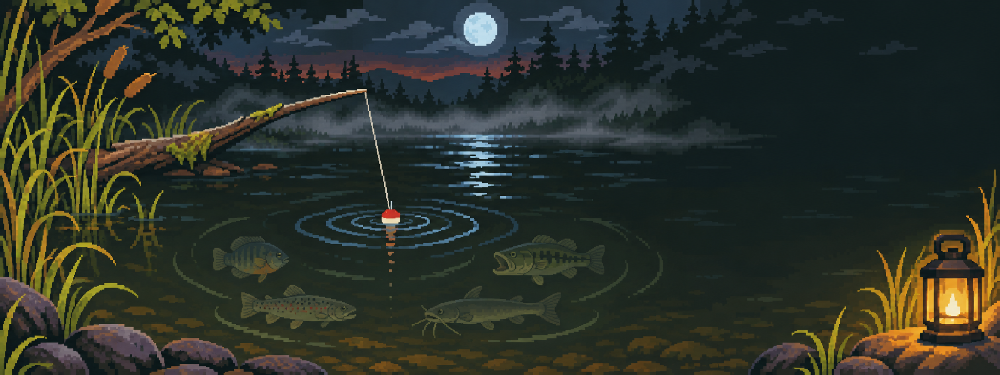

<p align="center"></p>

# BLACKWATER

**An ambient musical river for the M-VAVE FM-1.** Settle into deep, slowly evolving sound. Reflections grow
strange as the music opens; an approaching fish gathers the river into a sharp FISH ON moment, followed by a
fight, a reveal, and a gradual return to still water.

This checkout is the first river-experience review build. Three sound worlds — DUSK, UNDERTOW, FIREFLIES — use
the actual firmware's six-operator FM voices, effects and filtered stereo texture. Four musical layers are
independent of fish species. One line supports all eight existing species, active fishing or unattended listening.
There is no casting minigame in this build.

The deployed site, if available at <https://michaelaperry.github.io/Blackwater/>, remains the previous published
version until a separately authorized deployment. This local review build has not been published.

- PLAY enters the river; REC places/lifts the line or answers a bite.
- PRESET while stopped explicitly loads a sound world; K1–K4 mix current, bed, light and distance.
- SEQ opens bait, depth, waiting time, and FISH/LISTEN settings. SELECT/K1 reel on the river/line pages.
- Existing FM editing, live keys, effects, MIDI, saved patches, catch log, and USB backup remain available.
- v0.3 session/patch/log restore is tested against an actual old-format backup.

Review captures: `python3 tools/render_river_review.py --video` after building the host simulator. This writes
three WAV studies and a 110-second video from the actual host application to `build/river-review`. Its thirty-second
wait is explicitly chosen for demonstration; approach, fight, reveal and recovery run at their normal pace.

Full controls: **[the manual](docs/MANUAL.md)**.

## Status

A development review build. Host simulator and engine tests exercise the redesigned river. The previous build's
native/Wasm/Chromium package evidence is historical; the new device package and browser still need verification
once cloud toolchain/SDK download access is available. **Not tested on a physical FM-1.** Package identity `FM-1_77xx`.

## Build

```sh
./tools/setup.sh                       # pinned submodules, a Python venv with Pillow, the desktop simulator
. build/venv/bin/activate
./tests/run_tests.sh                   # engine, art importer, clip, and the app on fm1-base's host simulator
platform/fm1-base/tools/get_toolchain.sh /opt/jieli
tools/get_sdk_files.sh build/ac79-sdk  # the three AC79 SDK files the package needs, checked against their hashes
JIELI_TOOLCHAIN=/opt/jieli/toolchain AC79_SDK=build/ac79-sdk ./build.sh   # firmware/build/blackwater.fwsc
```

Pushes to `main` build the package, check it in the emulator (native, WebAssembly, Chromium) and publish the
site (`.github/workflows/pages.yml`).

## Documents

- [Manual](docs/MANUAL.md): playing BLACKWATER
- [Development](docs/DEVELOPMENT.md): source map, tests, design notes
- [Package and emulator evidence](docs/PACKAGE_EMULATION.md): the device build and what was verified, and how
- [Art prompts](docs/ART_PROMPTS.md): how the pixel art was made, and what to make next
- [Rights](docs/RIGHTS.md): the clip and the portrait
- [Project record](PROJECT.md): decisions and status
- [History](docs/history/): the original audit, research and handoff notes

## Credits and licences

BLACKWATER's code is GPL-3.0-or-later ([LICENSE](LICENSE)). It is built on
[fm1-base](https://github.com/charlesvestal/fm1-base) and [felucca-bsp](https://github.com/hugelton/felucca-bsp)
(MPL-2.0) and runs in the browser through [fm1-emu](https://github.com/joakimeriksson/fm1-emu) (MIT) by
Joakim Eriksson. Pixel art was made by the project's owner with ChatGPT image generation. Details:
[THIRD_PARTY.md](THIRD_PARTY.md).

BLACKWATER is an unofficial fan project. It is not affiliated with, sponsored or endorsed by Jeremy Wade, Fish On!,
River Monsters or Oxford Scientific Films, and not by M-VAVE. The FISH ON! portrait is an original pixel-art homage;
the one-second "Fish on!" sample is a sound in an original musical work. Rights holders who would like either
changed or removed can [open an issue](https://github.com/MichaelAPerry/Blackwater/issues).
